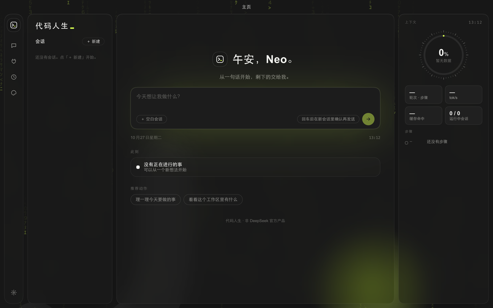
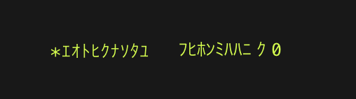
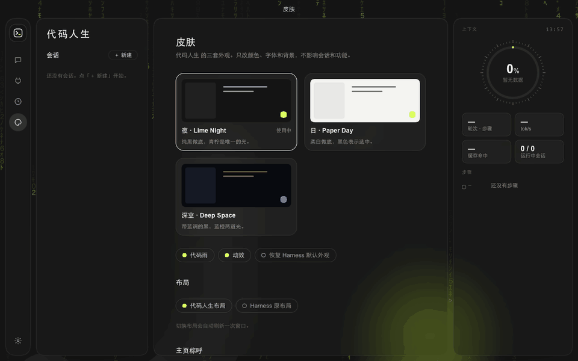
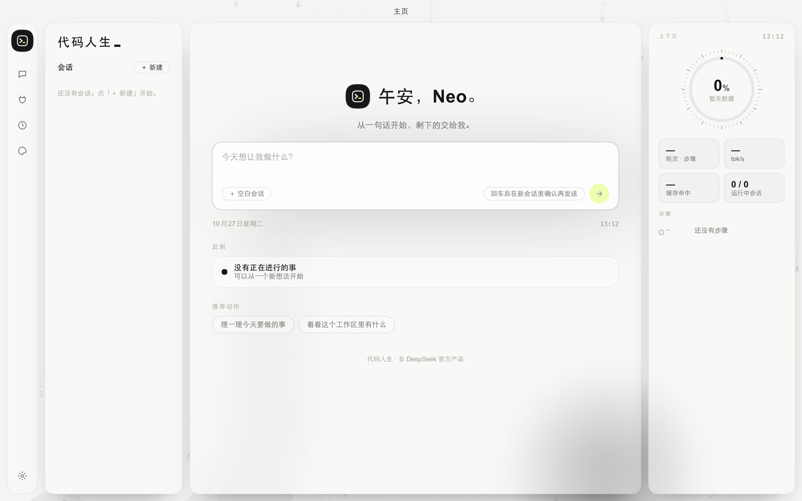
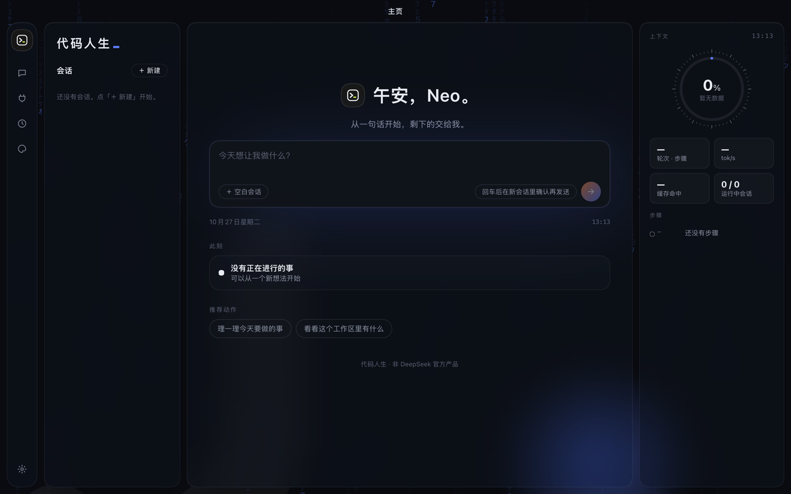
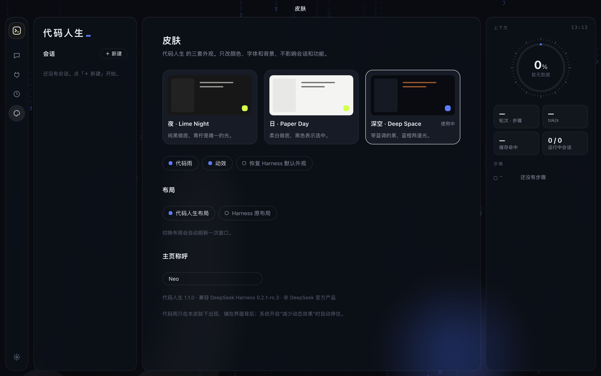
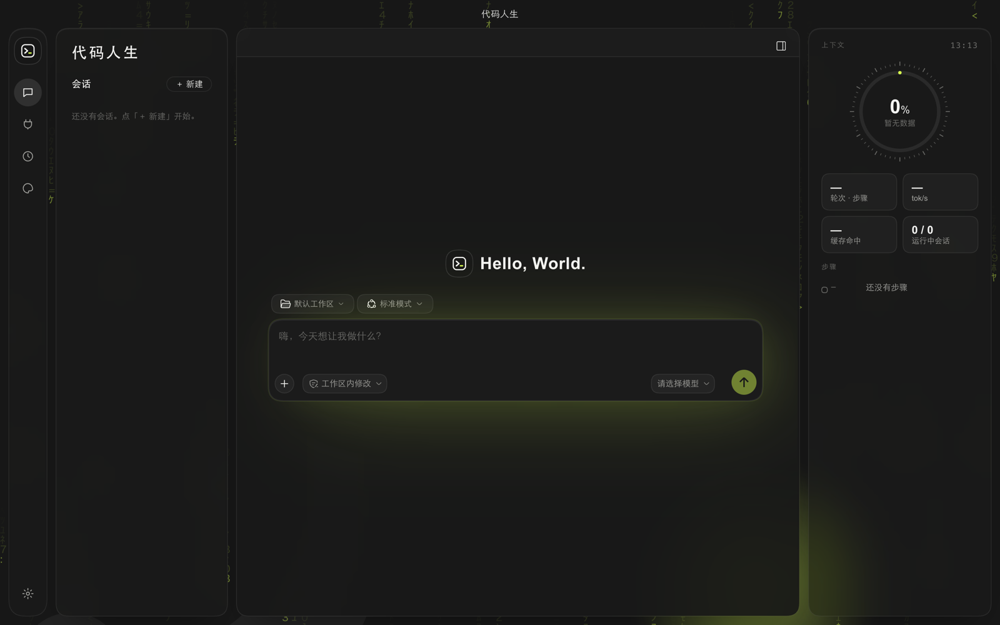

# 代码人生 Code Life · DeepSeek Harness 皮肤

> 把 DeepSeek Harness 装进代码世界：三套主题、自绘四栏布局、主页问候、背景代码雨，模型干活时状态文字先乱码再逐字解码。

**非 DeepSeek 官方产品。** 通过 Harness 官方插件机制安装，不修改 Harness 安装包，随时可以卸载。

[English](README_EN.md) · [更新记录](CHANGELOG.md) · [问题反馈](../../issues)





## 三套主题



| 夜 · Lime Night | 日 · Paper Day | 深空 · Deep Space |
|---|---|---|
|  |  |  |
| 纯黑做底，青柠是唯一的光 | 柔白做底，黑色表示选中 | 带蓝调的黑，蓝橙两道光 |

## 你会得到

- **自绘四栏布局**：图标栏 ／ 会话栏 ／ 对话区 ／ 仪表栏（上下文占用、轮次步骤、速度、缓存命中、步骤列表）
- **主页**：按时间和任务状态问候你；“此刻”最多 3 件事、推荐动作、最近会话、工作区全景
- **代码感细节**：背景代码雨（可关）、运行中跳动乱码＋状态文字逐字解码、青柠方块光标、终端风标志
- **随时切回**：皮肤页一键切回 Harness 原布局；系统开启“减少动态效果”时动画自动停住

| 皮肤页 | 新会话 |
|---|---|
|  |  |

## 系统要求

- macOS（Apple 芯片或 Intel）；其他系统可手动安装
- DeepSeek Harness **0.2.1-rc.3**（Harness 仍是预览版，升级后部分样式可能失效，会跟进兼容更新）

## 获取与安装

个人版 ¥49，在爱发电购买（店铺链接上线后更新在这里）。付款后自动回复里有你的**授权码**。

在「终端」里运行这一行（把 `<授权码>` 换成你的）：

```bash
curl -fsSL https://raw.githubusercontent.com/lianggangyao-tech/code-life-harness-skin/main/get.sh | bash -s -- <授权码>
```

装好后完全退出 Harness（⌘Q）再打开，左侧图标栏点「皮肤」选主题。

**让 AI 助手帮你装**：把上面这行命令和授权码发给 DeepSeek Harness 或其他能执行终端命令的 AI 助手，说“帮我运行这行命令安装代码人生皮肤”。给助手看的详细步骤在 [AGENTS.md](AGENTS.md)。

安装包放在本仓库的 [Releases](../../releases) 里，是加密的，需要授权码才能打开。卸载：运行安装目录（`~/Library/Application Support/CodeLifeSkin/`）里的 `uninstall.command`，或在皮肤页切回“Harness 原布局”。

## 隐私

皮肤只在你本机运行，不联网、不收集任何数据。主页上的会话、昵称都是从你本机 Harness 实时读取的。

## 本仓库

这里是**展示、发布与反馈仓库**：介绍、截图、更新记录、加密安装包和问题反馈。皮肤源码不在本仓库公开。

发现问题或有想要的功能，请在 [Issues](../../issues) 里提。

## 声明

DeepSeek、DeepSeek Harness 是其各自权利人的商标或产品名称，本项目与 DeepSeek 无关联，仅用于说明兼容对象。

出品：JAYO studio 工作室 · © 2026 保留所有权利。
